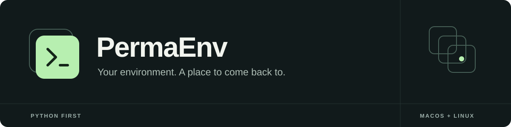

<div align="center">



**A Python-first toolkit for portable developer environments on macOS and Linux.**

[](https://github.com/ogbozoyan/PermaEnv/actions/workflows/ci.yml)
[](https://www.python.org/)
[](LICENSE)


[Get started](#get-started) · [Current status](#current-status) · [Contribute](CONTRIBUTING.md) · [Report an issue](https://github.com/ogbozoyan/PermaEnv/issues/new/choose)

</div>

---

Setting up a new machine should not mean reconstructing years of small decisions.
Your shell, editor extensions, language runtimes and AI tools are part of how you work.
PermaEnv is being built to give that environment a history—and a way home.

```text
                      P E R M A E N V

        Discover  →  Snapshot  →  Compare  →  Restore
                         │
                         └── Back up to
                             Local · Git · Google Drive
```

*The flow above describes the product direction. This repository currently ships the CLI foundation.*

## Current status

**Pre-alpha.** Available today:

- An installable Python package and `permaenv` command.
- `permaenv doctor`: a read-only check of the platform and selected executables on `PATH`.
- Human-readable output and a versioned JSON report for scripts.
- Tests, linting, type checks and package builds in GitHub Actions on macOS and Linux.

Snapshots, backups, restoration, application adapters, MCP and the interactive menu
are **not implemented yet**. Do not rely on this version to protect or recover your settings.

## Get started

You need [uv](https://docs.astral.sh/uv/getting-started/installation/) and Git.

```bash
git clone https://github.com/ogbozoyan/PermaEnv.git
cd PermaEnv
uv sync --locked

uv run permaenv --help
uv run permaenv doctor
uv run permaenv doctor --json
```

The repository selects Python 3.12 by default; the package supports Python 3.12+.
uv can provision the selected interpreter when it is not available locally.

To install the command into its own environment after cloning:

```bash
uv tool install .
permaenv doctor
```

### Homebrew distribution

Homebrew is a supported distribution target for the CLI on macOS and Linux.
**The first release and tap have not been published yet.** Once available, installation
and updates will use:

```bash
brew install ogbozoyan/tap/permaenv
brew upgrade permaenv
```

Builds already generate a `permaenv.rb` formula alongside the Python packages, using
source checksums and runtime dependencies from `uv.lock`. The formula installs Python
and keeps PermaEnv's dependencies in its own virtual environment. The future macOS
desktop app will be distributed separately as a Homebrew cask.

### What `doctor` checks

It reports the operating system, architecture, Python version and the paths of tools
such as Git, Homebrew, npm, Node.js, uv, Zsh, VS Code, IntelliJ IDEA, Codex and Claude.

**It only checks executable availability on `PATH`.** It does not run these tools,
read their configuration files, scan your home directory or send data anywhere.
A missing command is reported as **Not on PATH**; it does not prove the application
is uninstalled. Optional tools do not cause a failed check. An unsupported operating
system returns exit code `1`.

JSON output goes to stdout without terminal formatting. The report includes
`schema_version`, `platform` and `tools`; command paths can contain your username,
so review output before sharing it in a public issue.

## Where PermaEnv is headed

| Area | Planned experience |
| :--- | :--- |
| Environment history | Select what matters, capture a snapshot and inspect changes |
| Backups | Choose a local directory, Git repository or Google Drive folder |
| Recovery | Review a restore plan, resolve conflicts and preserve files before changes |
| Editors & shells | User settings and plugins for VS Code, JetBrains IDEs and Zsh |
| Packages & runtimes | Track package sources, installed versions and separate installations |
| AI tools | Carry supported MCP configurations, instructions and skills between machines |
| Extensibility | Add simple apps with recipes and complex integrations with adapters |
| Interfaces | CLI and terminal UI first; MCP and a desktop companion follow |

Project-local configuration is outside the initial scope. Secrets, caches and chat
history will require explicit handling rather than copying entire application folders.

## Built with

The current CLI uses **Python, Typer and Rich**, packaged with **Hatchling** and managed
with **uv**. Development checks use **pytest, Ruff and mypy**.

The next components will use **Textual** for the terminal UI, the official **Python MCP SDK**,
and **SQLite** for local metadata. The future desktop stays on **Tauri 2 + React + TypeScript + Vite**,
with a Python core running as a managed local process. The application logic stays in Python.

## Development

```bash
uv sync --locked
uv run ruff check .
uv run ruff format --check .
uv run mypy
uv run pytest
uv build
uv run twine check dist/*
```

CI runs the tests on Python 3.12, 3.13 and 3.14 across macOS and Linux. It also builds
the wheel and source distribution, installs the wheel into a separate environment,
and uploads both distributions plus a generated Homebrew formula as workflow artifacts.
A manual **Build artifacts** workflow produces the same artifacts. Pushing a `v<version>`
tag matching `pyproject.toml` prepares a **draft GitHub release** with those files.
No package registry or tap is updated automatically.

To prepare the Homebrew artifact locally after `uv build`:

```bash
uv run python scripts/generate_homebrew_formula.py --sdist dist/*.tar.gz > dist/permaenv.rb
ruby -c dist/permaenv.rb
```

For a release, publish the draft with its original source archive, then add the generated
formula to `Formula/permaenv.rb` in the planned `ogbozoyan/homebrew-tap` repository.
The formula's source URL becomes usable only after that release is published. Test the
tap with `brew install --build-from-source ogbozoyan/tap/permaenv` and
`brew test ogbozoyan/tap/permaenv` on macOS and Linux before announcing availability.
The generator refuses dependency graphs it cannot represent safely in one formula;
extend it and its tests when adding platform-specific runtime dependencies.

## Contributing

Small, focused contributions are welcome: reproducible bug reports, platform fixes,
tests and improvements to the CLI foundation. For a new integration, open an issue
describing the application, its configuration locations and the state worth preserving.

Start with [CONTRIBUTING.md](CONTRIBUTING.md). Never include credentials, real environment
backups or private application data in a pull request.

## License

[MIT](LICENSE) © 2026 ogbozoyan and contributors.
